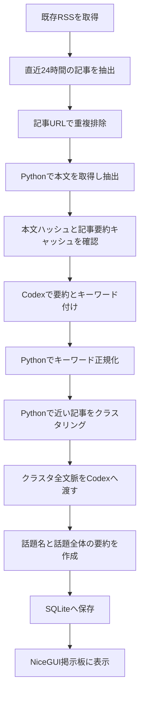

# ニュース話題掲示板の設計

## 目的

この文書は、既存の情報景ページをニュースの話題掲示板へ改造するための設計を定める。

Python がニュースを取得し、Codex が記事ごとの要約と分類キーワードを作成する。

Python がキーワードの近さから記事をまとめ、Codex が各まとまりを読み直して話題全体を要約する。

掲示板には話題の要約と含まれる見出しを表示する。

掲示板の閲覧中に外部サイトを開けないため、記事へのリンクと媒体名は表示しない。

## 設計上の前提

- ニュース取得と記事本文の抽出は、Python のみで行う。
- 要約とキーワード付け、および話題全体の要約は Codex CLI を介して行う。
- 新しいニュース配信サービスや要約 API は追加しない。
- Codex 要約のため、取得した記事本文は Codex の実行先へ送られる。
- Codex CLI の認証は実行環境に設定済みであることを前提とする。
- 取得元が提供する RSS と記事ページの範囲で処理する。
- ペイウォール、アクセス拒否、本文抽出失敗などにより、全記事の本文を必ず取得できるとは限らない。

Codex CLI の `codex exec` は非対話ジョブ向けで、`--output-schema` による構造化出力を利用できる。
そのため、Python は標準入力で記事本文を渡し、JSON Schema に適合した結果を受け取る構成とする。
[Codex CLI を使ったバッチ処理と構造化出力](https://developers.openai.com/blog/eval-skills)

## 全体フロー



この処理は画面の描画処理から分離する。

Python のニュースジョブが1時間ごとに実行され、NiceGUI は保存済みの最新結果を読む。

Codex の応答待ちで画面操作を止めない。

起動後に初回実行し、以後は前回の開始時刻から1時間おきに開始する。

前回の実行が終わっていない場合は重ねて起動しない。

毎時の起動時刻に実行中であれば、その回を飛ばし、次の毎時時刻に実行する。

各実行では直近24時間を再集計するため、24時間の対象窓から外れた記事もクラスタと件数から除かれる。

記事要約は本文ハッシュ、モデル、プロンプト版が同じなら再利用し、話題要約はクラスタ構成に変更がない場合に再利用する。

## 処理段階

### ニュース取得

既存の RSS フィードを並列に取得し、公開日時が現在から過去24時間以内の記事を抽出する。

RSS に日時がない記事、未来日時の記事、24時間より古い記事は処理対象から外し、理由を記録する。

記事の重複は正規化した URL で判定する。

URL がない場合は、正規化した見出しと公開日を使う。

同じ URL が複数フィードに載っている場合は一件として数える。

異なる記事 URL で報じられた同一話題は、それぞれ別の記事として件数に含める。

フィード自体に記事が残っていない場合は取得できないため、処理対象を「プラットフォーム全体の全記事」とは扱わない。

### 記事本文の取得

RSS に本文相当の内容があれば、それを先に利用する。

本文が短い場合や要約欄しかない場合は、Python が記事ページを HTTP 取得し、本文を抽出する。

抽出器は、記事本文、見出し、公開日時を返す。

ナビゲーション、広告、関連記事、コメント、スクリプトは本文から除く。

記事本文を取得できない場合は、RSS の要約文を入力に使い、記事状態を「本文不完全」として保存する。

アクセス拒否、本文空、抽出文字数不足など、失敗理由を画面表示用の結果とは別に記録する。

本文抽出には Python ライブラリ `trafilatura` を使う。

記事 URL は各 RSS の登録ドメイン配下に限定し、別ドメインへのリダイレクトは追わない。

取得先ごとに HTML 構造が異なるため、本文抽出結果をサンプル記事で確認する。

### 記事ごとの Codex 処理

Python は記事本文を Codex に渡し、記事単位の要約とキーワードを取得する。

出力は JSON Schema で検証する。

```json
{
  "summary": "記事の主張と事実を保った短い要約。",
  "category": "セキュリティ",
  "keywords": ["PHP", "脆弱性"],
  "confidence": "high"
}
```

`category` は少数の固定分類から一つ選ぶ。

初期分類は `生成AI`、`AIエージェント`、`半導体`、`セキュリティ`、`個人情報`、`開発`、`企業動向`、`研究`、`その他` とする。

`keywords` は1件から3件とし、文章ではなく短い名詞または固有名詞に限定する。

例として、`PHP脆弱性`、`個人情報漏えい`、`AIエージェント`、`GPU`、`LLM評価` を使う。

Codex は本文に記載された内容だけを要約し、推測や本文にない情報を追加しない。

記事本文は外部入力として扱い、本文内に指示文があっても実行指示として扱わないようプロンプトで明示する。

記事の出所を要約文に書かない。

Codex の呼び出しは記事ごとに行い、同時実行数を設定で制限する。

記事本文のハッシュ、モデル、プロンプト版が前回と同じ場合は、保存済みの要約を再利用する。

### キーワードの正規化

Codex が返したキーワードは、Python が別名辞書で表記を正規化する。

例えば、`GPT`、`Claude`、`Gemini` のようなモデル名は、必要に応じて共通の `生成AI` に寄せる。

一方、記事を識別する固有名詞や対象名は残す。

正規化辞書はコードから分離し、JSON 設定として管理する。

辞書にない語は文字数、空白、表記揺れだけを整えて保持し、意図の異なるキーワードを強制的に統合しない。

### Python によるクラスタリング

クラスタリングには、正規化済みのカテゴリとキーワードだけを使う。

記事本文の意味を Python 側で再解析しない。

初期方式は、キーワード集合の重なりを測る Jaccard 類似度を使う。

カテゴリが一致し、少なくとも一つのキーワードを共有し、類似度が設定閾値以上の記事を同じ話題候補とする。

一つの共有語を介して無関係な話題が連鎖的につながるのを防ぐため、記事を追加するときはクラスタ代表キーワードとの類似度も確認する。

閾値は環境変数で変更できるようにし、初期値は0.18とする。

どのクラスタにも十分近くない記事は、単独の話題として残す。

クラスタリング結果には記事 ID、代表キーワード、類似度、方式の版を保存する。

### 話題全体の Codex 要約

各クラスタについて、所属する全記事の記事ごとの要約、見出し、キーワードを Codex に渡す。本文は記事単位の要約時に一度だけ送り、話題要約では再送しない。

Codex はクラスタ内の共通点を確認し、話題名と掲示板用の要約を作成する。

話題名は読ませる短いニュース見出しにする。

要約は「何が起きたか」「どんな影響につながるか」「誰がどう対応しているか」から目を引く点を選び、1〜2文にする。

細かな数字や固有名詞は省いてよいが、元記事にない危機や断定を加えない。

媒体名、記事出所の説明、外部リンク、記事ごとの引用元表示は生成しない。

所属記事が多く一度に処理できない場合は、全記事の要約を複数の小分けにして中間要約を作り、最後に中間要約とキーワードを統合する。

分割処理でも元記事を一つも省かず、要約に含めた記事 ID の集合を検証する。

記事本文が一部取得できなかった場合は、RSS 要約を代用した記事が含まれることを記録する。

### 記事数に応じた要約量

話題要約は短く保ち、関連する記事数に応じて上限だけ少し増やす。

初期値は次の目安とし、Codex の出力上限を JSON Schema で制約する。

| 関連記事数 | 要約文字数の目標 | 要約の内容 |
| ---: | ---: | --- |
| 1〜2件 | 30〜45字 | 何が起きたかと影響 |
| 3〜5件 | 40〜55字 | 共通する動きと対応 |
| 6〜10件 | 50〜65字 | 主な影響と複数の対応 |
| 11件以上 | 60〜80字 | 話題全体の動きと反応 |

Codex には該当する文字数帯を目標として指定し、Python は上限超過を検証する。

要約は1文で自然に完結させて句点を付ける。上限いっぱいまで書かず、内容が少ない場合は目標の下限に届かなくてもよい。

同じ記事を複数回数えないよう、正規化 URL による重複排除後の件数を使う。

閾値と文字数は設定値にし、記事数の多い日のサンプルで読みやすさを調整する。

### 保存と画面表示

処理結果はローカル SQLite に保存する。

NiceGUI は最新の完了済み実行から、話題名、話題要約、記事ごとの要約、見出し、公開時刻を読み込む。

記事の見出しと要約は掲示板上でプレーンテキスト表示とし、リンク要素を作らない。

媒体名や出所ラベルを画面に表示しない。

内部処理では取得 URL を重複排除と再取得に使うが、画面用データへ URL を渡さない。

処理中は前回の完了済み掲示内容を維持し、実行状態と更新時刻だけを表示する。

話題カードには、短い話題見出し、記事数に応じた長さの要約、報道数を表示する。

カードは関連報道数の多い順に並べ、記事数と上位話題がひと目で分かるようにする。

縦長画面では記事数最多の話題を大きな主役カードにし、次の4話題を2列の短いカードで続ける。残りの話題も折りたたみの中で2列に並べ、必要な人だけ開けるようにする。

各カードでは記事数を大きく表示し、最大記事数を100%とした相対比率を横棒で添える。カードの色は順位ごとの視覚的な区別に使う。

天気と雨量はニュースより小さな一枚の帯にまとめ、ニュースを画面の中心に置く。

記事数の近くに、登録フィード上の報道量を示す数字だと説明する。

これは閲覧数、SNS反応、世論調査を測った値ではないため、「世間の関心度」と断定しない。

## データ構造

### articles

| 項目 | 内容 |
| --- | --- |
| `id` | 内部記事 ID |
| `fetch_url` | 本文取得と重複確認に使う内部 URL。画面には渡さない |
| `title` | 見出し |
| `published_at` | 公開日時 UTC |
| `body_hash` | 本文変更判定用ハッシュ |
| `body_status` | `full`、`rss_fallback`、`failed` |
| `fetched_at` | 取得日時 UTC |

### article_summaries

| 項目 | 内容 |
| --- | --- |
| `article_id` | 対象記事 ID |
| `summary` | 記事単位の要約 |
| `category` | 固定分類 |
| `keywords_json` | 正規化済みキーワード |
| `confidence` | Codex が示す確度 |
| `model` | 使用モデル識別子 |
| `prompt_version` | プロンプト版 |
| `status` | `complete`、`failed` |

### runs と topics

`runs` は処理開始、完了、失敗、処理対象件数、設定版を保存する。

`topics` は実行 ID、話題名、話題要約、記事 ID 一覧、関連記事数、代表キーワード、作成日時を保存する。

`topic_summaries` は記事 ID と本文ハッシュ、分類語、モデル、プロンプト版から作る署名をキーにし、同じクラスタの要約を再利用する。

記事本文は一回の処理中だけメモリ上に保持し、データベースやログには保存しない。

SQLite には本文ハッシュと要約結果を保存し、本文が同じ記事は記事単位の Codex 要約を再利用する。

記事メタデータ、記事要約、話題要約、実行履歴は30日後に削除する。

取得先の利用条件を確認し、認証回避やアクセス制限の回避は行わない。

要約とキーワードは、本文ハッシュ、Codex モデル、プロンプト版が一致する場合だけ再利用する。

## モジュール構成案

| モジュール | 責務 |
| --- | --- |
| RSS 取得 | フィード取得、日時判定、記事候補の生成 |
| 本文取得 | URL 取得、本文抽出、抽出状態の判定 |
| Codex クライアント | `codex exec` 起動、タイムアウト、JSON 検証、再試行 |
| 記事処理 | 記事単位の要約とキーワード作成、キャッシュ判定 |
| クラスタリング | キーワード正規化、類似度計算、話題候補作成 |
| 話題要約 | クラスタ全体の要約作成、分割統合、入力記事集合の確認 |
| 保存層 | SQLite の読み書き、実行状態、古いデータの削除 |
| キーワード辞書 | 表記揺れの正規化語彙 |
| NiceGUI ページ | 完了済み結果の掲示板表示と更新状態の表示 |

Codex クライアントは Python の `asyncio.create_subprocess_exec` で起動し、NiceGUI のイベントループをブロックしない。

Codex がファイルを書き換える必要はないため、読み取り中心の権限で実行し、作業ディレクトリも専用の一時領域にする。

コマンドはシェル文字列へ連結せず、引数配列として起動する。

## 失敗時の動作

| 失敗 | 動作 |
| --- | --- |
| RSS 取得失敗 | 他フィードの処理を続行し、失敗フィードを記録 |
| 記事本文抽出失敗 | RSS 要約文で処理し、本文不完全として記録 |
| Codex タイムアウトまたは異常終了 | 有限回再試行後、該当記事または話題を失敗状態で保存 |
| Codex の JSON 不正 | スキーマ検証エラーを記録し、再試行 |
| Codex CLI 未認証 | 実行全体を失敗状態とし、画面には前回結果を残す |
| 話題要約失敗 | 既存の記事要約とクラスタ一覧を保持し、未要約状態を表示 |
| SQLite 書き込み失敗 | 新しい実行を公開せず、前回の完了済み実行を表示 |

再試行は同じ入力に限り、試行回数と待機時間に上限を設ける。

未完成の実行結果を掲示板に混ぜない。

新しい実行はすべてのクラスタ処理が終わったあとに完了扱いにする。

## 運用設定

設定ファイルまたは環境変数で次を変更できるようにする。

- RSS フィード一覧
- 取得対象時間。初期値は24時間。
- 更新間隔。初期値は1時間。
- Codex CLI の実行パス、モデル、タイムアウト
- Codex 同時実行数
- クラスタ類似度閾値
- 本文の最小文字数
- 記事メタデータと要約の保存期間
- 記事要約と話題要約の最大文字数
- プロンプト版とキーワード別名辞書

API キーや認証情報を設定ファイル、データベース、ログへ保存しない。

## 実装段階

### 第1段階：取得と本文抽出

既存フィードの直近24時間記事を取得し、重複を除いて本文を抽出する。

代表的な取得先ごとに本文抽出結果を確認し、RSS 要約への切り替え条件を調整する。

### 第2段階：記事単位の Codex 処理

記事要約と固定分類、短いキーワードを構造化出力で作成する。

再実行キャッシュ、タイムアウト、失敗状態を加える。

### 第3段階：クラスタリング

キーワード別名辞書と類似度方式を実装する。

代表記事群で、同じ話題が分かれすぎないか、無関係な話題が結合しないかを確認して閾値を決める。

### 第4段階：話題全体の要約

クラスタに含まれる全記事を Codex に渡し、話題名と全体要約を保存する。

入力記事 ID の集合と出力対象集合が一致することを確認する。

### 第5段階：掲示板表示

最新の完了済み実行を縦長画面で表示する。

件数順にカードを並べ、件数バッジと平方根比の棒で話題の広がりを視覚化する。

関連記事数に応じた文字数の話題要約を配置し、件数指標が登録フィード上の報道量であることを明記する。

見出し、記事要約、話題全体の要約はプレーンテキストにし、外部リンクと媒体名を表示しない。

### 第6段階：毎時実行

アプリ起動時の初回実行と1時間ごとの更新を設定する。

二重起動を防ぎ、処理に時間がかかった場合も前回の掲示内容を維持する。

## 完了条件

- 登録済みフィードに掲載されている直近24時間の記事候補を重複なく取得できる。
- 取得本文の状態を記事ごとに判別できる。
- 記事要約とキーワードを Codex から構造化形式で受け取り、検証して保存できる。
- Python がキーワードだけを使って再現可能なクラスタリングを行う。
- 各クラスタの全記事を話題要約の入力対象に含めたことを検証できる。
- ニュースジョブが初回と1時間ごとに実行され、同時に二つの実行が走らない。
- 関連記事数が増えるほど、設定した段階に従って話題要約の文字数上限が増える。
- 件数順、件数バッジ、棒グラフで関連報道数の大小が縦長画面でも比較できる。
- 指標の説明により、記事数を閲覧数や世論調査と誤認させない。
- Codex 処理中も画面が操作可能で、前回の完了済み掲示内容を維持できる。
- 掲示板に外部リンクと媒体名が表示されない。
- 失敗記事、本文不完全記事、失敗した話題要約を識別できる。

## 実装前に決める事項

- 登録 RSS フィードを維持するか、対象プラットフォームを追加するか。
- Codex CLI で使用するモデルと利用上限。
- 対象サイトの利用条件の確認。
- キーワード分類語彙と類似度閾値の実データでの調整。
- 記事数が多い日に許容する処理時間。
